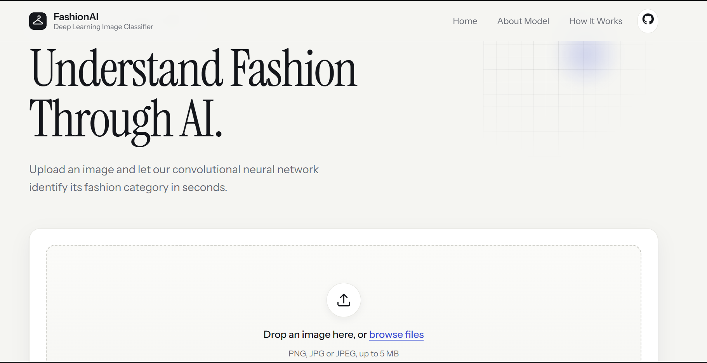
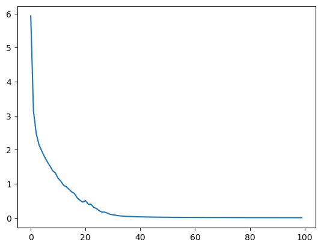
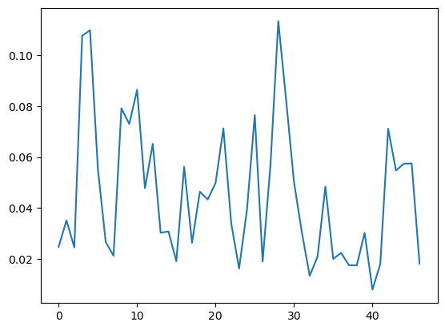

# FashionAI — Fashion Image Classifier

A deep learning-based image classification application that predicts the category of a clothing item from an uploaded image. The project uses a **Convolutional Neural Network (CNN)** built with PyTorch and a **FastAPI** backend to serve predictions through a simple web interface.

## 🚀 Live Demo

**[Try FashionAI](https://fashionai-bvoc.onrender.com)**

Upload a clothing image and let the trained CNN predict its category!

## 🖥️ Application Preview



## ✨ Features

- Upload a clothing image through the web interface.
- Predict the clothing category using a trained CNN model.
- Display the predicted class and confidence score.
- FastAPI backend for model inference.
- Lightweight frontend built with HTML, CSS, and JavaScript.
- Image preprocessing before prediction.

## 🛠️ Tech Stack

| Component | Technology |
|---|---|
| Programming Language | Python |
| Deep Learning Framework | PyTorch |
| Model Architecture | Convolutional Neural Network (CNN) |
| Backend | FastAPI |
| Frontend | HTML, CSS, JavaScript |
| Image Processing | Pillow, torchvision |
| Server | Uvicorn |
| Deployment | Render |

## 📊 Dataset

The project uses the **Fashion-MNIST dataset**, containing grayscale images of clothing items.

- Image dimensions: 28 × 28 pixels
- Input channels: 1 (grayscale)
- Number of classes: 10

| Class ID | Clothing Category |
|---:|---|
| 0 | T-shirt/top |
| 1 | Trouser |
| 2 | Pullover |
| 3 | Dress |
| 4 | Coat |
| 5 | Sandal |
| 6 | Shirt |
| 7 | Sneaker |
| 8 | Bag |
| 9 | Ankle boot |

## 🧠 Neural Network Architecture

A custom Convolutional Neural Network was implemented using PyTorch to extract spatial features from clothing images and classify them into 10 categories.

### Architecture Overview

```text
Input Image
(1 × 28 × 28)
       │
       ▼
┌─────────────────────────────┐
│       Convolution 1         │
│       Conv2D (1 → 32)       │
│       Kernel: 3 × 3         │
│       Padding: Same         │
│       Batch Normalization   │
│       ReLU                  │
│       MaxPool2D (2 × 2)     │
└─────────────────────────────┘
       │
       ▼
Feature Map
(32 × 14 × 14)
       │
       ▼
┌─────────────────────────────┐
│       Convolution 2         │
│       Conv2D (32 → 64)      │
│       Kernel: 3 × 3         │
│       Padding: Same         │
│       Batch Normalization   │
│       ReLU                  │
│       MaxPool2D (2 × 2)     │
└─────────────────────────────┘
       │
       ▼
Feature Map
(64 × 7 × 7)
       │
       ▼
     Flatten
     (3136)
       │
       ▼
   Linear (3136 → 128)
       │
       ▼
      ReLU
       │
       ▼
   Linear (128 → 64)
       │
       ▼
      ReLU
       │
       ▼
   Linear (64 → 10)
       │
       ▼
   Output Logits
       │
       ▼
  10 Clothing Classes
```

### Layer-wise Structure

| Layer | Configuration | Output Shape |
|---|---|---|
| Input | Grayscale image | 1 × 28 × 28 |
| Conv2D | 1 → 32, kernel 3 × 3, same padding | 32 × 28 × 28 |
| BatchNorm2D + ReLU | 32 channels | 32 × 28 × 28 |
| MaxPool2D | 2 × 2 | 32 × 14 × 14 |
| Conv2D | 32 → 64, kernel 3 × 3, same padding | 64 × 14 × 14 |
| BatchNorm2D + ReLU | 64 channels | 64 × 14 × 14 |
| MaxPool2D | 2 × 2 | 64 × 7 × 7 |
| Flatten | 64 × 7 × 7 | 3136 |
| Linear + ReLU | 3136 → 128 | 128 |
| Linear + ReLU | 128 → 64 | 64 |
| Output Linear | 64 → 10 | 10 |

### Why This Architecture?

- Convolutional layers learn spatial features such as edges, textures, and clothing patterns.
- Batch Normalization helps stabilize the training process.
- ReLU introduces non-linearity.
- Max Pooling reduces spatial dimensions while retaining important features.
- Fully connected layers perform the final classification.

## ⚙️ Model Training

The model was trained using the following configuration:

| Parameter | Value |
|---|---|
| Optimizer | SGD |
| Learning Rate | 0.01 |
| Weight Decay | 0.0001 |
| Loss Function | CrossEntropyLoss |
| Batch Size | 32 |
| Epochs | 100 |
| Input Shape | 1 × 28 × 28 |
| Number of Classes | 10 |

### Training Performance



### Testing Performance



**Test Accuracy: 86.33%**

## 🚀 Getting Started

### 1. Clone the Repository

```bash
git clone https://github.com/Amank0106/YOUR_REPOSITORY.git
cd image_classifier
```

### 2. Create and Activate a Conda Environment

```bash
conda create -n image_api python=3.11
conda activate image_api
```

### 3. Install Dependencies

```bash
pip install -r requirements.txt
```

### 4. Run the Application

```bash
python -m uvicorn main:app --reload
```

### 5. Open the Application

Visit:

```text
http://127.0.0.1:8000
```

FastAPI interactive documentation:

```text
http://127.0.0.1:8000/docs
```

## 🔌 API Endpoints

| Method | Endpoint | Description |
|---|---|---|
| GET | `/` | Serves the web application |
| GET | `/health` | Checks API health |
| POST | `/predict` | Accepts an image and returns a prediction |

### Example Prediction Response

```json
{
  "prediction": "Sneaker",
  "class_id": 7,
  "confidence": 0.95
}
```

*Example response format; actual predictions and confidence values depend on the uploaded image.*

## 📁 Project Structure

```text
image_classifier/
│
├── frontend/
│   ├── index.html
│   ├── style.css
│   ├── app.js
│   └── logo.svg
│
├── images/
│   ├── image.png
│   ├── training.png
│   └── testing.png
│
├── main.py
├── model.py
├── preprep.py
├── fashion2.pth
├── requirements.txt
├── .gitignore
└── README.md
```

## 🔮 Future Improvements

- Improve classification accuracy through further model experimentation.
- Experiment with more advanced CNN architectures.
- Explore additional data augmentation techniques.
- Improve generalization on real-world clothing images.

## 👨‍💻 Author

**Aman Kumar**

B.Tech — Electronics and Communication Engineering

[GitHub](https://github.com/Amank0106) · [LinkedIn](https://www.linkedin.com/in/amankumar016/)

---

*Built as a hands-on Deep Learning project to explore CNNs, image preprocessing, model training, and deployment using FastAPI.*